  

  

  <a href="https://github.com/anthonyamaro15/nevi">nevi</a> · <a href="https://github.com/anthonyamaro15/file-finder-rust">ff</a> · <a href="https://github.com/oxc-project/oxc/pulls?q=is%3Apr+author%3Aanthonyamaro15+is%3Amerged">oxc PRs</a> · <a href="https://anthonyamaro.dev">anthonyamaro.dev</a> · <a href="https://www.linkedin.com/in/anthonyamaro15">LinkedIn</a>

